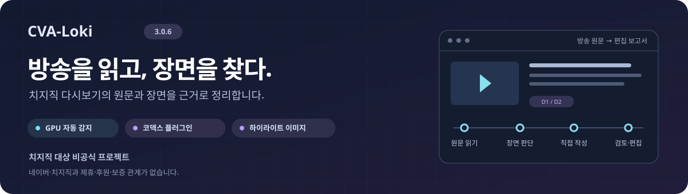
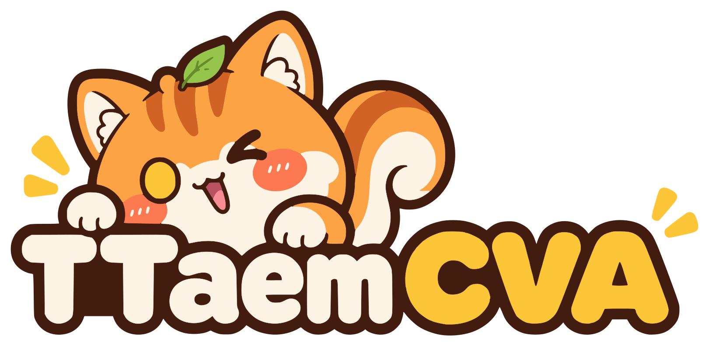
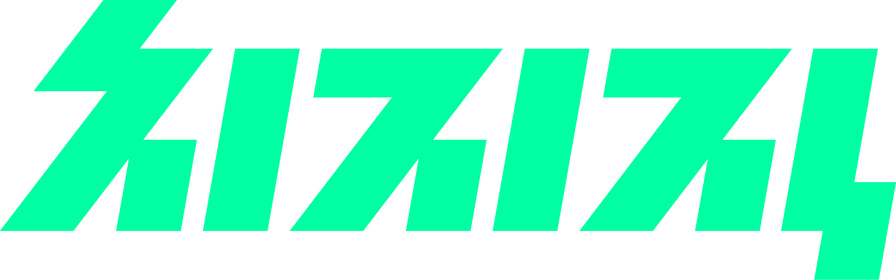
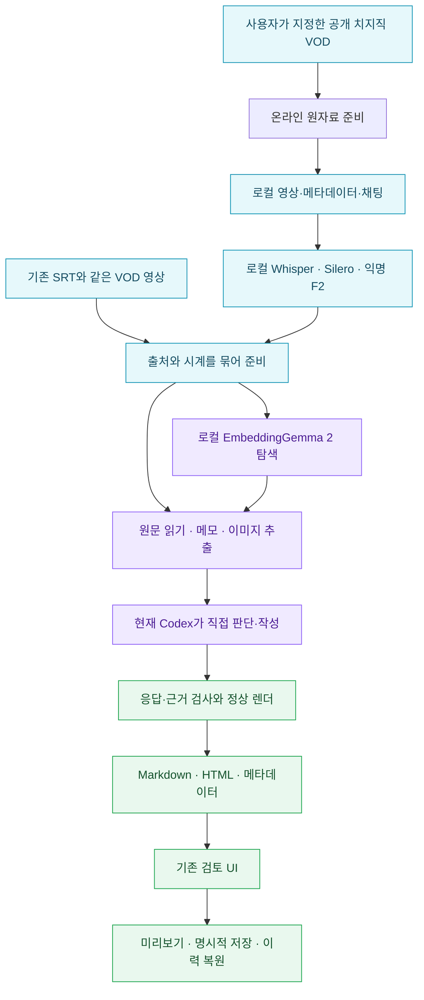

<p align="center">
  
</p>

<h1 align="center">CVA-Loki 3.0.5</h1>
<h1 align="center">이 레포의 링크와 vod 링크를 주고 요약을 만들어달라고 하세요</h1>
<p align="center"><strong>치지직 다시보기를 읽고, 장면을 찾고, 보고서를 다듬는 도구</strong></p>

<p align="center">
  <a href="https://ttaem.com"></a><br />
  <a href="https://ttaem.com">ttaem.com</a> · <a href="https://github.com/ttaem00/CVA-Loki">CVA-Loki 원본 저장소</a>
</p>

<p align="center">
  <a href=".codex-plugin/plugin.json"></a>
  <a href="#requirements"></a>
  <a href="#codex-integration"></a>
  <a href="#docker-install"></a>
  <a href="#images"></a>
  <a href="LICENSE"></a>
</p>

<p align="center">
  <a href="#quickstart"><strong>바로 설치</strong></a> ·
  <a href="#codex-integration">플러그인·스킬</a> ·
  <a href="#verification">설치 검증 범위</a> ·
  <a href="#policy">정책 확인</a>
</p>

<p align="center">
  <a href="https://chzzk.naver.com/"></a>
</p>
<p align="center"><strong>치지직 대상 비공식 프로젝트</strong><br />네이버·치지직이 제작·운영하는 공식 서비스가 아니며, 제휴·후원·보증 관계가 없습니다.<br />치지직 명칭과 로고의 권리는 네이버에 있습니다.</p>

치지직 로고는 대상 플랫폼을 안내하기 위해 원본 형태로 표시합니다. [치지직 공식 로고 사용 안내](https://help.naver.com/service/23946/contents/23364?lang=ko&osType=COMMONOS)의 형태·색상·비율 보존, 제휴 오인 금지, 상업적 목적 사용 금지 조건을 따릅니다. CVA의 이용허락은 치지직 로고나 방송 원자료의 이용 권리까지 부여하지 않습니다.

공개 치지직 VOD 또는 기존 자막·영상으로 시작해 **요약 → D1/D2 타임라인 → Point·Story·Highlight → 검토·편집**으로 이어집니다. 현재 대화의 Codex가 내용을 판단하고, Loki는 원자료 준비·근거 검사·보고서 저장을 맡습니다.

| 원문에서 시작 | 장면을 근거로 선택 | 기존 UI로 마무리 |
| :--- | :--- | :--- |
| 공개 VOD 준비와 로컬 Whisper 전사 | 실제 프레임 추출과 EmbeddingGemma 2 탐색 | 보고서 읽기·편집·미리보기 |
| 출처·시계·읽기 기록을 보존 | **현재 Codex가 반환 이미지를 직접 확인** | 명시적 저장·재열기·이력 복원 |

> [!TIP]
> **설치는 한 명령, 작성은 현재 Codex와 함께.** 기본 설치는 전체 기능과 GPU 자동 선택을 사용합니다. 플러그인과 스킬은 같은 런타임을 사용하며, 다른 모델에 보고서 작성을 넘기지 않습니다.

<details>
<summary><strong>목차 펼치기 — 설치·사용·설정·문제 해결</strong></summary>

| 시작·설치 | 작성·편집 | 설정·운영 |
| :--- | :--- | :--- |
| [빠른 시작](#quickstart) | [공개 VOD 준비](#source-preparation) | [설정](#configuration) |
| [기능 범위](#features) | [현재 Codex가 직접 작성](#authoring) | [설치 검증](#verification) |
| [구조와 네트워크](#architecture) | [이미지·멀티모달](#images) | [작업공간과 결과](#outputs) |
| [준비 사항과 GPU](#requirements) | [검토·편집 UI](#review-ui) | [문제 해결](#troubleshooting) |
| [로컬 설치](#native-install) | [플러그인·스킬](#codex-integration) | [정책·개인정보·비용](#policy) |
| [Docker 설치](#docker-install) | [FAQ](#faq) | [라이선스·공식 자료](#references) |

</details>

---

<a id="quickstart"></a>
## 빠른 시작

### 1. 배포 폴더를 준비하세요

CVA-Loki 3.0.5는 정식 요약 메커니즘 Loki 3.0.5를 포함한 배포본입니다. [3.0.5 배포 파일](https://github.com/ttaem00/CVA-Loki/releases/tag/v3.0.5)의 `CVA-Loki-3.0.5.zip`을 해제하거나 아래 명령으로 [원본 저장소](https://github.com/ttaem00/CVA-Loki)를 clone한 뒤, 그 폴더에서 시작하세요. 설치 전 [이용·배포 정책](#policy)을 확인하세요.

배포·플러그인·스킬·요약 메커니즘 버전은 모두 **3.0.5**이며, 새 작업의 `latest`도 **Loki 3.0.5**를 선택합니다. 기존 작업의 메커니즘 식별자와 결과 이력은 보존합니다. 이미 설치한 3.0.4 작업공간을 덮어쓰지 말고 새 배포본은 새 작업공간에 설치하세요.

```sh
git clone https://github.com/ttaem00/CVA-Loki.git
cd CVA-Loki
```

### 2. 설치할 곳을 선택하세요

**호스트 Codex에 플러그인으로 설치**

```sh
python install.py --workspace ../loki-plugin-workspace --mode plugin
```

**특정 작업공간에 스킬로 설치** · 해당 폴더에서 `$loki`로 사용

```sh
python install.py --workspace ../loki-workspace --mode skill
```

**Docker에 설치** · 호스트와 분리된 환경에서 사용

```sh
docker compose run --build --rm loki
```

| 직접 준비할 것 | 설치기가 자동 준비할 것 |
| :--- | :--- |
| 로컬: Python 3.11+와 venv/ensurepip | 전용 환경, Node/npm, FFmpeg, Python 라이브러리 |
| Docker: 실행 중인 Docker와 Compose 2.30+ | 컨테이너 Python, 선택 모드의 Codex CLI·플러그인/스킬 |
| GPU: 지원 드라이버, Docker 사용 시 GPU 노출 | GPU 감지·장치별 PyTorch·실제 실행 확인 |
| 최초 다운로드를 위한 인터넷·저장공간 | EmbeddingGemma 2·Whisper·Silero VAD·F2 자산 |

**기본값: 전체 기능(`multimodal`) · GPU 자동 선택(`auto`)**. 감지된 GPU의 실행 실패를 CPU 성공으로 숨기지 않습니다. GPU가 없는 Docker 호스트는 [CPU override](#docker-install)를 사용하세요. 호스트 드라이버는 설치기가 변경하지 않습니다.

### 3. 설치 결과를 확인하고 현재 Codex에서 시작하세요

작업공간의 `installation-result.json`에서 전체 결과와 실제 실행 장치를 확인합니다. 설치한 작업공간을 Codex에서 열고, 새 채팅에서 `$loki`와 VOD URL 또는 기존 자료를 전달하세요.

> [!IMPORTANT]
> **설치 위치를 확인하세요.** Docker 명령은 컨테이너에 설치합니다. 호스트의 Codex Desktop에서 바로 쓸 때는 위의 플러그인 또는 스킬 설치를 선택하세요. 플러그인 설치는 동봉 설치기를 사용하며, 공개 스토어 자동 등재를 뜻하지 않습니다.

<details>
<summary><strong>복사해서 지시하기 — 현재 Codex에게 설치부터 보고서 작성까지 한 번에 요청</strong></summary>

### 현재 Codex에게 한 번 지시하기

이 저장소를 다운로드하거나 clone한 뒤, 해당 폴더를 열어 둔 현재 Codex에 다음처럼 요청하세요.

> README와 Loki 스킬을 읽고, 이 컴퓨터에 맞는 기본 전체 기능을 설치해줘. 배포 폴더 밖의 새 작업공간을 사용하고 GPU 감지·실행 결과를 확인해줘. 설치가 끝나면 내가 준 치지직 VOD를 준비하고, 네가 Loki의 원문과 반환 이미지를 직접 읽어 새 보고서를 작성·제출해줘. 마지막으로 검토 UI를 열어줘. 외부 게시는 하지 마.

VOD URL은 실제 요청할 `https://chzzk.naver.com/video/영상번호`로 함께 전달하세요. 기존 SRT로 시작하려면 URL 대신 해당 파일과 확인된 VOD 정보를 알려주면 됩니다.

</details>

<a id="features"></a>
## 할 수 있는 일

| 기능 | 요약 메커니즘 3.0.5 동작 |
| --- | --- |
| 공개 VOD 준비 | 익명 접근 가능한 치지직 VOD 한 개의 영상·메타데이터와 사용 가능한 공개 채팅을 준비합니다. |
| 로컬 STT | 고정 Whisper large-v3-turbo와 Silero VAD로 전사하고 기존 자막 후처리·단어 정렬·익명 F2 전환 분리를 사용합니다. |
| 원문 읽기와 메모 | 출처·시계·revision에 연결된 원문을 읽고 유용한 판단 메모를 보존합니다. |
| 보고서 작성 | 현재 Codex가 요약·D1/D2·Point·Story·Highlight를 직접 작성합니다. |
| 이미지 추출 | 같은 VOD의 로컬 영상에서 제한된 구간의 실제 프레임을 추출하고 선택 이미지를 보고서에 연결합니다. |
| 멀티모달 탐색 | 로컬 EmbeddingGemma 2가 text/image/audio/video 근거 후보를 찾고 캐시합니다. |
| 검토 UI | 기존 목록·영상 작업실·상세 편집 UI에서 확인·편집·미리보기·저장·재열기·이력 복원을 수행합니다. |
| 결과 보존 | 원자료·읽기 기록·응답·Markdown/HTML·메타데이터·수동 수정 이력을 작업공간에 보존합니다. |

<details>
<summary><strong>VOD·D1/D2·Point·Story·Highlight 용어 보기</strong></summary>

| 용어 | 뜻 |
| --- | --- |
| VOD | 방송이 끝난 뒤 볼 수 있는 다시보기 영상입니다. |
| D1 · D2 | 방송 목차의 큰 주제와 그 안의 세부 주제입니다. |
| Point | 주목할 만한 순간과 그 시각입니다. |
| Story | 장면의 앞뒤 맥락과 눈여겨볼 이유를 설명합니다. |
| Highlight | 볼 만한 장면의 시작·끝 구간입니다. 별도 영상 파일을 만드는 기능은 아닙니다. |
| 작업공간 · workspace | 입력·모델·결과를 보관하는 폴더입니다. 배포 폴더와 분리합니다. |
| 영상 작업실 | 원문·영상·보고서를 확인하고 편집하는 화면입니다. |

</details>

포함하지 않는 기능도 있습니다.

- 방송 종료를 상시 감지하거나 주기적으로 VOD를 수집하는 daemon·스케줄러.
- 로그인·쿠키·브라우저 인증을 가져오는 비공개 VOD 수집.
- 영상 컷 편집이나 Highlight 영상 렌더링.
- 외부 사이트 공개, 네이버 카페 게시, 외부 댓글창 연결.
- 별도 Codex/Claude CLI·API 모델을 최종 작성자로 실행하는 기능.

외부 게시·카페·댓글 내보내기 연결은 검토 UI에서도 비활성화됩니다. 로컬 Markdown/HTML 저장은 사용할 수 있습니다.

<a id="architecture"></a>
## 작동 구조



<details>
<summary><strong>단계별 네트워크·작성 책임 보기</strong></summary>

| 단계 | 네트워크와 책임 |
| --- | --- |
| 설치 | 공개 패키지와 고정 모델을 내려받습니다. 작업공간의 환경과 캐시에 보존합니다. |
| 공개 VOD 준비 | 요청한 단일 VOD의 허용된 공개 API·미디어 연결을 사용합니다. 인증을 가져오지 않습니다. |
| 로컬 STT·임베딩 | 작업공간의 고정 모델과 로컬 자료를 사용합니다. 원격 ASR나 원격 임베딩 API로 자료를 보내지 않습니다. |
| 작성 도구 | `network=deny`, `author_mode=current_codex`로 고정합니다. 임의 셸·별도 작성자 실행을 허용하지 않습니다. |
| 현재 Codex 대화 | 실제로 읽어 전달한 원문·이미지는 현재 Codex 서비스의 입력입니다. 해당 계정·조직 정책이 적용됩니다. |
| 검토 UI | loopback의 로컬 서버에서 기존 보고서와 수정 이력을 다룹니다. 외부 게시를 실행하지 않습니다. |

**오프라인 작성 도구라는 말이 Codex 서비스 자체까지 오프라인이라는 뜻은 아닙니다.** Loki의 로컬 모델은 전사와 탐색을 맡고, 현재 Codex가 의미 판단과 최종 작성을 맡습니다.

</details>

<a id="requirements"></a>
## 준비 사항과 GPU 선택

### 실행 환경

| 경로 | 필요한 준비 |
| --- | --- |
| 로컬 설치 | Python 3.11 이상, venv·ensurepip 지원, 첫 설치의 인터넷 연결. |
| Docker 설치 | 실행 중인 Docker Desktop 또는 Docker Engine, Compose 2.30 이상. 호스트 Python·Node·Codex CLI는 필요하지 않습니다. |
| NVIDIA GPU | 지원되는 호스트 드라이버와 GPU 노출. Linux Docker는 NVIDIA Container Toolkit, Windows Docker Desktop은 지원되는 WSL2 GPU 구성이 필요합니다. |
| Apple Silicon | macOS용 네이티브 설치에서 MPS를 선택하며 실제 모델 실행 확인이 필요합니다. Linux Docker의 NVIDIA 경로와는 다릅니다. |
| CPU | 호환 GPU가 없거나 `--device cpu`를 명시한 경우 사용합니다. 긴 영상의 전사는 오래 걸릴 수 있습니다. |

`gpus: all`을 사용하는 Compose 항목은 [Docker 공식 문서](https://docs.docker.com/reference/compose-file/services/#gpus)에 따라 Compose 2.30 이상이 필요합니다. [GPU 접근의 호스트 준비](https://docs.docker.com/compose/how-tos/gpu-support/)도 확인하세요.

<details>
<summary><strong>GPU 선택 기준·드라이버·모델 용량·메모리 자세히 보기</strong></summary>

### 장치 선택

설치 기본값은 `--device auto`입니다.

1. 지원되는 NVIDIA GPU가 보이면 Linux/Windows용 공식 CUDA 12.8 PyTorch wheel을 선택합니다.
2. Apple Silicon macOS에서는 MPS를 선택하고 실제 실행 결과를 확인합니다.
3. 호환 GPU가 감지되지 않으면 CPU를 선택합니다.
4. NVIDIA가 감지됐지만 드라이버·Docker 노출·실행 검증이 실패하면 이유와 조치를 표시합니다. 이를 숨기고 CPU 성공으로 바꾸지 않습니다.

이 설치기의 CUDA 12.8 드라이버 사전 검사 기준은 Windows 570.65, Linux 570.26 이상입니다. 장치가 보인다는 사실과 실제 모델이 GPU에서 실행됐다는 사실은 별개입니다. 설치 결과의 `device_selection.selected`와 `device_selection.actual`을 확인하세요. 호스트 드라이버는 Loki가 설치하거나 바꾸지 않습니다.

AMD/ROCm 등 이 설치기가 자동 선택하지 않는 GPU backend가 감지되면 지원 범위 안내에 따라 명시적으로 CPU를 선택할 수 있습니다. Whisper·임베딩은 선택 장치를 사용하고, 기존 F2 감지는 별도 Sherpa CPU 작업자로 실행합니다.

### 디스크·메모리

모델 파일은 ZIP에 포함되지 않습니다. 첫 설치는 EmbeddingGemma 2 약 1.5GB, Whisper 가중치 약 1.62GB, F2 자산 약 47MB와 패키지를 내려받습니다. PyTorch·설치 캐시·원본 영상·추출 음성·벡터 캐시에도 추가 공간이 필요합니다.

기존 임베딩 worker에는 최소 8GiB 가용 RAM 검사가 있습니다. 이 검사는 모든 방송 길이·동시 작업·GPU 메모리 요구를 보장하는 사양표가 아닙니다. 설치나 처리 중 메모리 부족이 나면 다른 작업의 사용량과 실제 실패 로그를 확인하세요.

</details>

<a id="native-install"></a>
## 로컬 설치

저장소를 clone하거나 ZIP을 해제합니다.

```sh
git clone https://github.com/ttaem00/CVA-Loki.git
cd CVA-Loki
python install.py --workspace ../loki-workspace --mode skill
```

Windows에서는 실행 환경에 따라 `py -3`, macOS/Linux에서는 `python3`로 실행 이름을 바꿀 수 있습니다. 아래의 `<workspace-python>`, `<runtime>`, `<workspace>`는 설치 결과에서 확인한 실제 값으로 바꾸고, 공백이 있는 경로는 사용하는 셸에 맞게 인용하세요.

설치 도구가 수행하는 작업은 다음과 같습니다.

1. 배포 manifest와 작업공간 소유·경로를 확인합니다.
2. 설정을 초기화하고 작업공간의 전용 `.venv`를 준비합니다.
3. 선택 프로필의 Node/npm·FFmpeg·Python 의존성을 준비합니다.
4. 기본 전체 프로필에서는 장치를 감지하고 고정 임베딩·음성 자산을 준비합니다.
5. 스킬 또는 플러그인을 설치하고 실제 설치 경로를 확인합니다.
6. doctor, 합성 원문/보고서 검사, 해당 프로필의 미디어·임베딩 실행 검사를 수행합니다.
7. `installation-result.json`과 시도별 로그를 보존합니다.

시스템 Python 패키지를 설치 대상으로 사용하지 않으며 호스트 인증 파일을 가져오지 않습니다. `plugin` 모드는 선택된 Codex 환경에 marketplace·plugin 등록을 수행합니다. 일반 의존성·추가 CLI는 작업공간 안에 준비합니다.

<details>
<summary><strong>설치 프로필·CPU·모델 경로 옵션 보기</strong></summary>

### 설치 프로필과 옵션

| 옵션 | 의미 |
| --- | --- |
| `--features multimodal` | 기본 전체 설치. 원문/보고서/UI, 이미지 추출, text/image/audio/video 검색, 공개 VOD 준비, Whisper/Silero/F2. |
| `--features media` | 원문/보고서/UI와 로컬 이미지 추출. STT·임베딩 모델 다운로드는 포함하지 않습니다. |
| `--features core` | 원문 읽기·메모·검사·보고서와 검토 UI. 미디어 처리·모델 준비는 포함하지 않습니다. |
| `--device auto` | 기본 GPU 자동 선택. 전체 프로필에 적용합니다. |
| `--device cpu` | GPU가 있어도 CPU를 명시적으로 선택합니다. |
| `--model-source <directory>` | 고정 revision의 EmbeddingGemma 2 파일 13개를 명시한 폴더에서 해시 확인 후 복사합니다. Whisper/F2 다운로드를 대신하지 않습니다. |
| `--mode skill` | 작업공간의 `.agents/skills/loki`에 완전한 스킬을 설치합니다. |
| `--mode plugin` | marketplace 등록·native plugin 설치·설치된 캐시 확인을 수행합니다. |
| `--mode setup` | 이미 받은 완전한 스킬의 런타임으로 전용 환경을 준비할 때 사용합니다. |

```sh
python install.py --workspace ../loki-cpu --mode skill --device cpu
python install.py --workspace ../loki-media --mode skill --features media
```

`features` 값을 설정 파일에서 바꾸는 것만으로 의존성이 추가되지는 않습니다. 처음 필요한 기능에 맞게 설치 프로필을 선택하세요.

</details>

<a id="codex-integration"></a>
## Codex 플러그인·스킬 사용

### 스킬

로컬 설치가 끝나면 `loki-workspace`를 Codex의 작업 폴더로 열고 새 채팅에서 `$loki`를 사용합니다. `SKILL.md`만 복사하지 말고 `runtime/`, references와 라이선스를 포함한 전체 `loki/` 폴더를 보존하세요.

스킬 폴더만 받은 경우:

```sh
python /absolute/path/to/loki/runtime/install.py --workspace /absolute/path/to/new-workspace --mode setup
```

스킬의 정본은 [SKILL.md](skills/loki/SKILL.md), 상세 동작은 [작성 절차](skills/loki/references/workflow.md)와 [설정 안내](skills/loki/references/configuration.md)입니다.

### 플러그인

전체 배포 폴더에서 실행합니다.

```sh
python install.py --workspace ../loki-plugin-workspace --mode plugin
```

사용 가능한 Codex CLI가 있으면 사용합니다. 없으면 작업공간의 Node/npm과 전용 npm prefix에 고정 Codex CLI를 준비합니다. CLI는 marketplace 등록·설치·조회에만 사용하며 보고서 작성용 하위 모델을 실행하지 않습니다.

| 식별자 | 값 |
| --- | --- |
| 원본 저장소 | [`ttaem00/CVA-Loki`](https://github.com/ttaem00/CVA-Loki) · 공개 소스 저장소 |
| 배포 버전 | `3.0.5` |
| 요약 메커니즘 | `3.0.5` · `latest`는 `loki_3_0_5` 선택 |
| marketplace | `cva-loki` |
| plugin | `loki` / 설치 ID `loki@cva-loki` |
| skill | `loki` / 명시 호출 `$loki` |

설치 결과의 `native_plugin`과 `installed_runtime`을 확인하고, 플러그인을 설치한 Codex 환경의 새 로컬 채팅에서 사용하세요. 실제 읽기·작성은 그 채팅의 Codex가 수행합니다. 설치 캐시의 코드를 수정해서 작업하지 않고 별도 workspace에 입력·출력을 만듭니다.

OpenAI의 [플러그인 패키징 안내](https://developers.openai.com/plugins/build/plugins)는 marketplace를 통한 배포와 설치된 사본의 사용을 설명합니다. 이 저장소의 installer는 동봉한 배포본과 함께 고정한 CLI 흐름을 제공합니다. 플러그인이 universal public directory에 자동 등록됐다고 가정하지 마세요.

**Docker 내부 설치와 호스트 Desktop 설치는 별개입니다.** 컨테이너에서 만든 `loki_home`은 컨테이너용 설정입니다. 호스트 Codex에서 바로 사용하려면 호스트 경로로 설치하거나, 호스트에 보이는 작업공간과 실행 경로를 현재 Codex에 명시하세요. 호스트 인증 폴더를 컨테이너에 복사할 필요는 없습니다.

<a id="docker-install"></a>
## Docker 설치

### NVIDIA GPU 기본 경로

```sh
docker compose run --build --rm loki
```

컨테이너는 Python 공식 slim 이미지, OS FFmpeg, 비루트 사용자 `10001:10001`로 실행합니다. 나머지 기본 의존성과 모델은 workspace 전용 환경에 준비합니다. GPU 지원은 호스트 드라이버와 Docker 설정이 먼저 충족해야 합니다.

컨테이너 안의 plugin 모드:

```sh
docker compose run --build --rm loki --mode plugin
```

<details>
<summary><strong>CPU 설치·볼륨·결과 확인·호스트 Codex 연결 자세히 보기</strong></summary>

### CPU 경로

GPU가 없는 호스트에서는 GPU 요청을 제거하는 override를 함께 사용합니다.

```sh
docker compose -f compose.yaml -f compose.cpu.yaml run --build --rm loki
```

CPU plugin 모드:

```sh
docker compose -f compose.yaml -f compose.cpu.yaml run --build --rm loki --mode plugin --device cpu
```

GPU가 있는데 컨테이너에서 감지되지 않으면 우선 호스트의 GPU 노출을 해결하세요. CPU가 목적일 때는 CPU override와 `--device cpu`로 그 선택을 명확히 합니다. 파일 병합·override 원리는 [Docker 공식 안내](https://docs.docker.com/compose/how-tos/multiple-compose-files/merge/)를 따릅니다.

### 작업공간과 결과 보존

기본 named volume은 다음과 같습니다.

- `loki_workspace`: `/workspace`, 환경·모델·원자료·보고서.
- `loki_home`: `/home/loki`, 컨테이너에서 사용하는 Codex plugin 설정·캐시.

기본 설치는 호스트 인증 폴더·Docker socket을 연결하거나 포트를 열지 않습니다. 설치 컨테이너가 종료돼도 볼륨과 결과는 남습니다.

```sh
docker compose run --rm --entrypoint cat loki /workspace/installation-result.json
```

CPU 호스트에서 결과를 읽을 때도 같은 override를 사용합니다.

```sh
docker compose -f compose.yaml -f compose.cpu.yaml run --rm --entrypoint cat loki /workspace/installation-result.json
```

독립 설치를 나누려면 모든 명령에 같은 프로젝트 이름을 사용하세요.

```sh
docker compose -p my-loki run --build --rm loki
docker compose -p my-loki run --rm --entrypoint cat loki /workspace/installation-result.json
```

호스트 폴더를 직접 사용하려면 `LOKI_WORKSPACE`를 **이미 존재하고 UID 10001이 쓸 수 있는 절대 경로**로 지정합니다. 원자료·결과가 든 볼륨을 문제 해결 목적으로 삭제하지 마세요.

### 호스트 Codex에서 Docker 자료를 직접 읽기

호스트에서 열린 현재 Codex가 Docker 런타임을 조작하는 경우에도 별도 작성자 CLI를 시작하지 않습니다. 현재 Codex가 컨테이너 Python으로 Loki 명령을 실행하고, 반환된 원문과 이미지를 직접 읽어 응답을 작성합니다.

이미지를 호스트의 이미지 보기 도구로 확인하려면 호스트에 보이는 작업 폴더를 연결하는 편이 쉽습니다. 예를 들어 PowerShell에서는 다음처럼 준비합니다.

```powershell
New-Item -ItemType Directory -Path ../loki-docker-workspace -Force | Out-Null
$env:LOKI_WORKSPACE = (Resolve-Path ../loki-docker-workspace).Path
docker compose -p my-loki run --build --rm loki
```

이 경우 컨테이너의 `/workspace`가 지정한 호스트 폴더에 대응합니다. 반환된 `/workspace/work/...` 이미지는 호스트의 `loki-docker-workspace/work/...`에서 확인합니다. 실행은 계속 컨테이너의 `/workspace/.venv/bin/python`으로 수행하며, Linux용 가상환경을 호스트 Python으로 실행하지 않습니다. 컨테이너용 spec에는 `/workspace/...` 경로를 사용하고 원자료의 시간·해시는 바꾸지 않습니다.

기본 named volume을 유지한다면 현재 Codex가 선택한 원문·이미지 파일만 명시적으로 호스트 작업 폴더에 꺼내 확인해야 합니다. 인증 폴더를 연결하거나 컨테이너의 모든 파일을 가져올 필요는 없습니다. Linux bind mount는 해당 경로에 UID 10001의 쓰기 권한이 필요합니다.

</details>

<a id="source-preparation"></a>
## 공개 VOD로 원자료 준비

공개 VOD 한 개를 영상·메타데이터·자막으로 준비한 뒤 현재 Codex의 작성 흐름에 연결합니다.

<details>
<summary><strong>공개 VOD 준비 명령·옵션·prepare spec 보기</strong></summary>

기본 전체 설치 뒤 실제 반환된 Python과 runtime 경로로 실행합니다.

```sh
<workspace-python> <runtime>/source_acquire.py --workspace <workspace> --vod https://chzzk.naver.com/video/<video-number>
```

| 인수 | 범위 |
| --- | --- |
| `--workspace` | 설치한 작업공간. |
| `--vod` | 단일 `https://chzzk.naver.com/video/숫자` URL. |
| `--height` | 144, 360, 480, 720, 1080 중 하나. 기본 480. |
| `--max-download-seconds` | 다운로드 단계 제한. 기본 21600초, 허용 60–21600초. STT 전체 시간 제한이 아닙니다. |

다운로드한 영상은 오디오·비디오 스트림과 길이를 검사합니다. 준비 계약의 정수 duration은 검증한 미디어 길이를 올림해 마지막 소수점 자막 cue가 제외되지 않게 하며, 정확한 미디어 길이와 원본 시작 offset은 clock 기록에 보존합니다.

요청별 파일은 `work/<video_no>/source-<attempt>/`에 남습니다. 이전 입력이나 사용자 메모를 덮어쓰지 않고, STT 실패 뒤에도 검증된 다운로드 체크포인트를 재사용할 수 있습니다. 익명 접근이 안 되는 VOD는 인증 우회 없이 실패합니다. 사용 가능한 공개 채팅은 선택 자료이며 채팅 수집 실패 자체가 전사 성공을 무효화하지는 않습니다.

Docker에 설치했다면 같은 볼륨을 연결한 서비스에서 런타임을 실행할 수 있습니다.

```sh
docker compose run --rm --entrypoint /workspace/.venv/bin/python loki -B /opt/loki/skills/loki/runtime/source_acquire.py --workspace /workspace --vod https://chzzk.naver.com/video/<video-number>
```

CPU Docker 설치에서는 이 명령에도 `-f compose.yaml -f compose.cpu.yaml`을 사용하세요.

### 준비 템플릿에서 작성으로 넘기기

결과의 `prepare_spec_path`는 **보고서가 아니라 작성 준비 템플릿**입니다. 다음 단계가 남아 있습니다.

1. 현재 Codex가 반환된 실제 영상·SRT·VOD 정보와 clock 기록을 읽습니다.
2. 템플릿에 실제 현재 채팅의 `author` 정보를 채웁니다. 확인하지 못한 모델명은 `unknown`으로 유지합니다.
3. 그 spec으로 `loki.py prepare`를 실행합니다.
4. 반환된 `author-input.json`과 원문·이미지를 실제로 읽습니다.
5. 현재 Codex가 응답을 작성하고 제출합니다.

`author_required=true`는 이 작성 과정이 남아 있다는 뜻입니다. 다운로드·STT 성공은 보고서 완성이나 현재 Codex의 시청·청취를 뜻하지 않습니다.

기존 workspace-owned 영상만 전사할 때는 다음 경로를 사용할 수 있습니다.

```sh
<workspace-python> <runtime>/transcribe_source.py --workspace <workspace> --video <owned-video> --output <new-sibling.srt>
```

영상은 `<work_dir>/<video_no>/` 아래에 있어야 하며 하위 source-attempt 폴더도 허용합니다. 출력은 입력 영상과 같은 폴더의 새로운 `.srt`여야 합니다. 기존 자막은 덮어쓰지 않습니다.

</details>

<a id="authoring"></a>
## 현재 Codex가 직접 작성

**현재 대화의 Codex가 원문과 실제 반환 이미지를 직접 읽고 판단합니다.** Loki는 원자료·읽기 기록·응답을 검사하고 새 정상 보고서로 저장합니다.

<details>
<summary><strong>prepare → 원문 읽기 → 판단·작성 → submit 상세 명령 보기</strong></summary>

원문 읽기의 기본 정책은 `balanced_compact_v1`입니다. `balanced_compact_v1`은 원문 문자·시각·원본 해시와 남은 cursor를 보존하면서 반복 부가정보를 줄입니다. 정책 필드가 없는 작업은 저장 당시의 serial 정책으로 재개합니다.

기본 검색은 기존 `lexical`입니다. 새 점수 결합 검색 `hybrid_dbsf_v1`은 **기본 꺼짐·명시 선택**으로 포함하며, 준비 spec의 `search_mode`와 저장된 검색 index 설정으로 선택한 작업에만 적용합니다. `search_mode`·`read_page_policy`는 `loki.json`의 추가 키가 아니라 작업별 준비 spec입니다. 명시한 `lexical`·exact 요청과 기존 작업의 cursor·응답 재사용은 유지합니다. 모델·revision·768차원과 기존 벡터를 임의로 바꾸거나 재계산하지 않습니다. 영상·음성 검색이나 정렬 방식에 이 선택을 일괄 적용하지 않습니다.

플러그인·스킬은 설치할 때 복사한 파일을 사용합니다. 배포 폴더의 파일을 바꿔도 설치된 사본이 자동으로 교체되지는 않습니다.


기존 자료로 시작할 때는 같은 VOD의 SRT와 확인된 방송 정보를 `<workspace>/<work_dir>/<video_no>/` 아래에 준비합니다. 방송 시작 시각과 다시보기 업로드 시각을 바꾸어 쓰거나, 다른 방송의 자료를 섞지 않습니다.

```sh
<workspace-python> <runtime>/loki.py --config <workspace>/loki.json doctor
<workspace-python> <runtime>/loki.py --config <workspace>/loki.json prepare --spec <workspace>/spec.json
```

`--config`는 subcommand 앞에 둡니다. 경로·작성자·필드는 [전체 spec 예시](skills/loki/references/workflow.md)를 따르세요. 공개 VOD 준비에서 받은 템플릿을 쓰는 경우에는 관측된 source 값과 경로를 유지하고 실제 author만 채웁니다.

`prepare`가 반환한 `job_root`, `prepared_revision`, `source_id`, `world_revision`, `author_input_path`를 보존합니다. **현재 Codex가** `author_input_path`를 열어 author prompt·응답 필드·원문 읽기 계약을 확인합니다.

원문 도구 action을 workspace의 JSON으로 저장한 뒤 실행합니다.

```sh
<workspace-python> <runtime>/loki.py --config <workspace>/loki.json read --job-root <job-root> --expected-revision <revision> --action <workspace>/read-action.json
```

검색·반응량·임베딩·이전 요약은 읽을 위치를 찾는 단서입니다. 인용할 완전한 자막 cue와 필요한 앞뒤 맥락을 실제로 읽어야 합니다. 메모는 `remember`, 재조회는 `memory`로 같은 source/revision에 연결합니다.

```sh
<workspace-python> <runtime>/loki.py --config <workspace>/loki.json remember --job-root <job-root> --expected-revision <revision> --note <workspace>/note.json
<workspace-python> <runtime>/loki.py --config <workspace>/loki.json memory --job-root <job-root> --expected-revision <revision> --query <query>
```

현재 Codex가 이 job의 실제 응답 계약에 맞는 새 JSON을 작성한 뒤 제출합니다.

```sh
<workspace-python> <runtime>/loki.py --config <workspace>/loki.json submit --job-root <job-root> --expected-revision <revision> --response <workspace>/response.json
```

`submit`은 새 로컬 보고서군을 만듭니다. 기존 보고서와 사용자 수정본을 덮어쓰거나 공개하지 않습니다. 정확히 같은 완료 제출의 재조회는 가능하지만, 완료된 job에 다른 응답을 넣으면 충돌합니다. 기존 제출 상태를 확인하고 충돌을 숨기려고 중복 job을 만들지 마세요.

</details>

<a id="images"></a>
## 이미지 추출과 멀티모달 검색

**3.0.3은 실제 하이라이트 프레임 추출을 지원합니다.** 로컬 EmbeddingGemma 2는 text/image/audio/video 근거 후보를 찾고, 최종 장면 선택과 보고서 작성은 현재 Codex가 맡습니다.

<details>
<summary><strong>이미지 추출·선택·멀티모달 탐색 명령과 역할 보기</strong></summary>

### 하이라이트용 이미지 추출

media 또는 기본 전체 프로필에서 같은 VOD의 로컬 영상을 prepare spec의 `media_path`에 지정합니다. 지원 파일은 `.mp4`, `.mkv`, `.webm`, `.mov`이며 소유 source 디렉터리 아래에 있어야 합니다.

이 목록은 이미지 추출 입력 형식입니다. 검토 UI의 내장 로컬 플레이어는 MP4를 사용하며 브라우저가 해당 영상·음성 codec을 지원해야 합니다. 공개 VOD 준비가 만든 MP4를 우선 사용하세요.

현재 Codex는 `read`를 통해 source-bound `read_frames`를 요청하고, 이어지는 `read_frame_page`를 필요에 맞게 읽습니다. 반환된 로컬 이미지를 현재 Codex의 이미지 보기 도구로 **실제로 확인**한 뒤 선택합니다.

```text
read_frames → 실제 반환 이미지 확인 → 필요한 다음 페이지 확인 → 응답에서 frame_ref 선택 → submit
```

이 job의 허용된 proposal/range 안에 넣는 이미지 선택의 예시는 다음과 같습니다.

```json
{
  "image": {
    "frame_ref": "<actual-returned-frame-ref>",
    "alt": "실제 이미지에서 확인한 장면 설명",
    "caption": "원문과 장면에 근거한 짧은 캡션"
  }
}
```

이 예시는 전체 응답이 아닌 일부 필드입니다. 실제 job의 `author-input.json`과 반환된 tool contract가 우선합니다. 선택 프레임은 proposal의 원본 구간 안에 있어야 합니다. 보고서는 전달된 이미지 바이트·해시·시간 바인딩을 보존하고 HTML에는 해당 선택의 WebP 파생 이미지를 표시합니다.

프레임 샘플 위치를 독립 검증된 원본 PTS나 청취 증거로 설명하지 않습니다. 이미지가 보이지 않거나 디코딩이 실패하면 그 제한을 남깁니다. 검토 UI에서는 선택 이미지의 근거와 시간을 읽기 전용으로 보존하며 이미지·캡션 교체 편집기를 제공하지 않습니다.

### EmbeddingGemma 2의 역할

`google/embeddinggemma-2`는 로컬 검색용 encoder입니다. **보고서 작성자나 승인자가 아닙니다.** text/image/audio/video 임베딩으로 관련 근거 후보를 찾고 캐시를 재사용합니다. `navigate_multimodal`의 결과도 실제 원문·이미지 확인으로 이어져야 합니다.

미디어 탐색 window는 1–30초이며 한 요청에 최대 3개를 사용합니다. 질문과 구간은 이 job이 반환한 정확한 계약과 source duration에 맞춥니다. 검색 점수가 높다는 이유로 보지 않은 장면이나 듣지 않은 음성을 확인했다고 기록하지 않습니다.

</details>

<a id="review-ui"></a>
## 보고서 검토·편집·복원

Loki는 기존 Report Admin의 **목록·영상 작업실·상세 편집 템플릿과 CSS/JS**를 재사용합니다. 별도 간이 편집 화면으로 대체하지 않습니다. local API·미디어 재생·revision·기능 범위 연결에 필요한 작은 adapter를 둡니다.

설치 결과의 `review.command`를 사용하거나 다음을 실행합니다.

```sh
<workspace-python> <runtime>/review.py --config <workspace>/loki.json --port 8787
```

기본 주소는 [http://127.0.0.1:8787/](http://127.0.0.1:8787/)입니다. 설치 결과의 `review.status=available_not_started`는 명령이 준비됐으며 서버가 아직 실행되지 않았다는 뜻입니다.

일반적인 검토 흐름은 다음과 같습니다.

1. 목록에서 보고서를 선택합니다.
2. 영상 작업실에서 로컬 영상과 장면·원문을 확인합니다.
3. D1/D2·Point·Highlight의 제목·내용·시각을 수정하고, 상세 화면에서는 전체 본문과 생성된 Story 맥락도 검토합니다.
4. 편집안의 미리보기를 확인하고 명시적으로 저장합니다.
5. 다시 열어 실제 저장 revision과 내용을 확인합니다.
6. 필요하면 기존 되돌리기 기록에서 이전 저장본을 비교하고 복원합니다.

수동 수정은 별도 revision으로 남고 최초 작성 제출은 보존됩니다. 저장 충돌이나 결과 불명 상태에서는 입력을 보존하고 최신 저장 상태를 확인합니다. 원문 SRT·이미지 근거·원본 시간은 편집 대상으로 바꾸지 않습니다. 저장·복원은 새 모델 요청이나 외부 공개가 아닙니다.

Docker에서는 설치와 동일한 프로젝트 이름·볼륨으로 review 서비스만 실행할 수 있습니다. 이 서비스 자체는 모델 추론을 요청하지 않아 GPU를 요구하지 않습니다.

```sh
docker compose -f compose.yaml -f compose.review.yaml up --build review
```

호스트에는 `127.0.0.1:8787`만 연결합니다. 인터넷이나 공유 네트워크에 직접 노출하지 마세요. 설치 컨테이너와 review 서비스의 workspace·프로젝트 이름이 다르면 보고서가 보이지 않을 수 있습니다.

<a id="configuration"></a>
## 설정

설정 파일은 작업공간의 `loki.json`입니다. 언어·입력/미디어 크기·기능 프로필과 작업 경로를 확인할 수 있습니다. 작성자는 `current_codex`, 작성 도구 네트워크는 `deny`로 고정됩니다.

<details>
<summary><strong>9개 설정 키·초기값·타입·허용 범위 보기</strong></summary>

설정은 workspace의 `loki.json`에 있습니다. 키는 정확히 9개이며 추가 키를 받지 않습니다. 다음은 수동 `init`의 core 초기값입니다. **기본 전체 설치가 만든 설정을 이 예시로 덮어쓰지 마세요.** 전체 설치는 실제 모델 runtime ref를 기록합니다.

```json
{
  "schema_version": "loki.workspace.v1",
  "language": "ko",
  "max_input_bytes": 50000000,
  "max_media_bytes": 20000000000,
  "features": "core",
  "multimodal_runtime": null,
  "network": "deny",
  "author_mode": "current_codex",
  "work_dir": "work"
}
```

| 필드 | 타입·범위와 의미 |
| --- | --- |
| `schema_version` | 문자열, 고정 `loki.workspace.v1`. |
| `language` | 문자열 `ko` 또는 `en`. 출력 언어이며 원문의 의미·시계를 바꾸는 설정이 아닙니다. |
| `max_input_bytes` | 정수 1,024–200,000,000. 기본 50,000,000. 텍스트·일반 입력 파일당 한도이며 총 RAM·토큰 예산이 아닙니다. |
| `max_media_bytes` | 정수 1,024–100,000,000,000. 기본 20,000,000,000. 명시된 로컬 미디어 한도입니다. 공개 수집기는 최대 20GB의 별도 상한도 적용합니다. |
| `features` | 문자열 `core`, `media`, `multimodal`. 실제 설치 프로필과 맞아야 합니다. |
| `multimodal_runtime` | `null` 또는 정확히 `{path, sha256}`인 해시 참조. 설치 도구가 기록한 실제 ref를 유지합니다. |
| `network` | 문자열, 고정 `deny`. 작성 런타임에 적용합니다. |
| `author_mode` | 문자열, 고정 `current_codex`. 다른 모델/provider 선택 키가 아닙니다. |
| `work_dir` | 작업공간 안의 상대 경로 문자열. 절대 경로·탈출·링크 경로를 사용하지 않습니다. |

Whisper·Silero·F2 runtime 참조는 `.loki-speech.json`에 별도로 기록합니다. 모델 manifest나 도구 receipt를 수동으로 만들어 readiness를 가장하지 마세요.

방송별 편집 선호·알려진 배경은 source 폴더의 `<video_no>_context.md` 등 [허용된 원자료 계약](skills/loki/references/workflow.md)으로 제공합니다. 원문에 없는 사건을 설정으로 만들어 넣지 않습니다. 준비 job은 입력을 고정하므로 이후 원자료를 바꾸면 revision/해시 불일치가 날 수 있습니다.

상세 경로·설치 옵션은 [configuration.md](skills/loki/references/configuration.md)를 참고하세요.

</details>

<a id="verification"></a>
## 설치 결과와 검증 범위

<a id="release-version-policy"></a>
### 정식 공개 전 후보 수정

현재 출시 대상은 **3.0.5**입니다. 정식 공개 전에 발견한 코드·설치·검사·운영 오류는
3.0.5 후보 안에서 고칩니다. 오류·재시도·재빌드를 이유로 3.0.6·3.0.5.1 등으로
자동 증분하거나 미완료를 다음 버전으로 넘기지 않습니다. 후보 차이는 기존 커밋·빌드·
파일 해시로 구분하며, 필요할 때만 기존 사전 공개 표기를 사용합니다.
이미 정식 공개한 태그·ZIP은 덮어쓰지 않으며, 공개 후 수정은 별도 후속 패치 절차를
따릅니다. 이전 작업의 호환성·보존 검증을 이전 버전의 새 출시로 해석하지 않습니다.

### 첫 공개 버전에서 확인한 범위

첫 공개 3.0.3에서는 새 Windows 작업공간의 **스킬 설치**와 깨끗한 Docker 환경의 **Codex 플러그인 설치·활성화**를 `core` 범위로 확인했습니다. 당시의 원문 읽기·제출·보고서 렌더링 합성 검사 기록과 배포 파일·해시는 별도로 보존하며, [3.0.3 소스 태그](https://github.com/ttaem00/CVA-Loki/tree/v3.0.3)도 유지합니다.

3.0.4는 설치기와 런타임을 수정한 별도 배포본입니다. [3.0.4 소스 태그](https://github.com/ttaem00/CVA-Loki/tree/v3.0.4)와 기존 배포 파일·해시·검증 기록을 보존하며, 3.0.3 설치 기록을 수정본 전체의 검증으로 대신하지 않습니다.

3.0.5는 제품·배포·플러그인·스킬·새 작업의 정식 메커니즘을 같은 버전으로 맞춘 배포본입니다. 이 버전의 패키지·새 작업공간 설치 검증 범위는 [3.0.5 배포 안내](https://github.com/ttaem00/CVA-Loki/releases/tag/v3.0.5)를 따릅니다. 이전 배포 태그와 ZIP, 기존 작업의 버전·원자료·보고서는 그대로 보존하며, 과거 배포본은 현재 다운로드 선택지에서 제외합니다.

**기본 설치는 전체 기능과 GPU 자동 선택입니다.** `core` 검사 성공을 전체 모델 준비·GPU 추론·실제 VOD 전사 성공으로 해석하지 않습니다. 사용 중인 환경의 실제 결과는 설치 후 생성되는 `installation-result.json`에서 확인하세요.

<details>
<summary><strong>설치 결과 파일 읽는 법과 검증 범위</strong></summary>

### 설치한 환경에서 확인할 값

명령 exit code가 0이고 workspace의 `installation-result.json`이 `status=PASS`, `kind=loki_installation`인지 확인합니다. 다음 값도 함께 읽습니다.

| 결과 | 확인할 내용 |
| --- | --- |
| `python`, `installed_runtime` | 이후 사용할 실제 interpreter와 runtime 경로. |
| `doctor` | `status=ready`, 빈 `missing_dependencies`. |
| `selftest` | 합성 원문 읽기·메모·검사·렌더·재조회·충돌 계약의 결과. |
| `local_tools`, `media_selftest` | 도구와 로컬 프레임 추출·이미지 연결 검사. media/full 프로필에서 확인합니다. |
| `multimodal.verification` | 기본 전체 프로필의 실제 네 모달리티 벡터·캐시 실행 결과. |
| `device_selection` | 요청·감지·선택 장치와 실제 검증 장치. |
| `speech` | 고정 Whisper·Silero·F2 자산과 runtime ref 준비 결과. |
| `native_plugin` | plugin 모드의 등록·설치·discovery 결과. |
| `attempt_id`, `logs` | 이 설치 시도와 최초 실패 단계의 로그. |

`speech.verification=assets_only_not_transcription`은 **자산 준비**입니다. 실제 STT 성공은 `transcribe_source.py`의 결과와 SRT·전사 receipt로 별도로 확인합니다. F2가 enabled라는 설정과 실제 감지 상태도 구분합니다.

합성 selftest는 `kind=synthetic_contract_selftest`, `semantic_author=synthetic_fixture_not_a_model`로 식별합니다. 고정 응답으로 검사하는 설치 계약이며 실제 방송의 작성·편집 품질 증거가 아닙니다. 실제 보고서는 현재 Codex가 실제 자료를 읽어 새로 작성해야 합니다.

패키지 자체를 확인하려면 전체 배포 폴더에서 실행할 수 있습니다.

```sh
python verify_release.py .
```

같은 설치 파일과 작업공간으로 설치를 다시 실행할 수 있습니다. 시도별 로그는 보존되고, `installation-result.json`에는 마지막 시도의 결과가 남습니다. 설치 재실행과 다른 배포 파일로 교체하는 업그레이드는 구분하세요.

</details>

<a id="outputs"></a>
## 자료와 결과가 저장되는 곳

환경·모델·원자료·읽기 기록·보고서·수동 수정 이력은 작업공간에 보존합니다.

<details>
<summary><strong>작업공간 디렉터리 구조와 결과 파일 보기</strong></summary>

기본 `work_dir=work`일 때의 구조입니다. 실제 job ID·보고서 이름·cache 이름은 반환된 결과가 정본입니다.

```text
loki-workspace/
├── loki.json
├── installation-result.json
├── installation-logs/              # 설치 시도별 stdout/stderr·성공·실패 기록
├── .venv/                          # 전용 Python·패키지·일부 로컬 도구
├── .agents/skills/loki/             # skill 모드의 설치 사본
├── .loki-tools.json                # 미디어 도구 경로·해시
├── .loki-speech.json               # 음성 runtime 해시 참조
├── .models/                        # 고정 모델·모델 metadata
├── .cache/                         # workspace 전용 설치·처리 캐시
├── verification/                   # 설치 검사용 합성 입력·출력
└── work/<video_no>/
    ├── <video_no>_context.md        # 사용자가 준비한 선택적 방송 맥락
    ├── source-<attempt>/           # 공개 VOD 준비 시 생성
    │   ├── 영상·SRT·전사 receipt
    │   └── prepare-spec.template.json
    └── current-conversation/<job_id>/
        ├── prepared.json
        ├── author-input.json
        ├── source-reads/
        ├── report/                # Markdown·HTML·메타데이터 보고서군
        └── review/                # 수동 preview·revision·현재 수정본 참조
```

plugin 모드의 설치 runtime은 Codex의 실제 반환 cache 경로를 사용합니다. workspace와 설치 cache는 서로 다른 위치일 수 있습니다. 작업공간을 이동하면 준비 파일의 절대 경로가 그대로 유효한지 확인해야 하며 자동 relocation을 가정하지 마세요.

</details>

<a id="troubleshooting"></a>
## 문제 해결

실패하면 `installation-result.json`의 **최초 실패 stage와 해당 로그**부터 확인하세요. 원자료나 모델 볼륨을 삭제하기 전에 아래 대응표를 확인합니다.

<details>
<summary><strong>GPU·의존성·플러그인·모델·저장 오류 해결표 펼치기</strong></summary>

| 증상·오류 | 확인과 대응 |
| --- | --- |
| Python/venv/ensurepip 준비 실패 | Python 3.11+와 venv 지원을 확인하거나 Docker 경로를 사용합니다. 기존 사용자 환경을 삭제하지 않습니다. |
| `workspace_must_be_separate_from_installed_files` | 저장소·설치 스킬 바깥의 새 workspace를 지정합니다. |
| `installed_skill_payload_changed` / inventory 불일치 | 설치 cache를 수동 편집하지 말고 실제 배포본·해시·설치 경로를 확인합니다. 다른 버전과 섞지 않습니다. |
| `cuda128_driver_update_required` | 해당 호스트 드라이버 조건을 확인합니다. 의도적으로 CPU를 사용할 때만 `--device cpu`를 선택합니다. |
| GPU가 호스트에는 있지만 Docker에는 없음 | 호스트 NVIDIA 드라이버·Container Toolkit/WSL2·Docker GPU 노출을 확인합니다. 컨테이너 패키지 설치만으로 해결하지 않습니다. |
| `gpu_backend_not_supported_by_this_installer` | 자동 지원하지 않는 backend 안내를 읽고 지원 환경이나 명시 CPU 경로를 선택합니다. |
| 모델 다운로드 실패·checksum 불일치 | 최초 실패 단계·네트워크·여유 디스크를 확인합니다. hash 검사를 끄지 않습니다. 원자료와 성공한 캐시는 보존합니다. |
| `runtime_doctor_not_ready` | 반환된 `missing_dependencies`와 실제 interpreter를 확인합니다. 다른 Python으로 실행하지 않았는지 확인합니다. |
| `register_marketplace` / `install_plugin` 실패 | 설치 로그에 기록된 Codex CLI와 `codex --version`, `codex plugin --help`를 확인합니다. PATH에 있는 CLI를 먼저 사용하므로 플러그인 명령을 지원하는 버전이 필요합니다. 오류를 해결한 뒤 같은 설치 명령을 다시 실행하세요. |
| `loki_configuration_shape` / `loki_configuration_policy` | 9개 필드·타입·범위·고정 정책을 확인합니다. provider/API key 등 추가 키를 제거합니다. |
| `loki_source_installed_public_adapter_required` | 이 배포본의 실제 runtime을 사용하는지 확인합니다. 다른 프로젝트의 모듈을 섞지 않습니다. |
| 공개 VOD 접근 실패 | 익명 공개 접근 가능 여부를 확인합니다. 로그인·구독·연령 제한은 우회하지 않고 허용된 로컬 자료를 사용합니다. |
| `loki_source_media_audio_tail_invalid` | 영상·오디오 끝 부분이 온전하지 않습니다. download/probe 로그를 확인하고 검증된 시도 기록에서 재개합니다. |
| STT 중단 | 최초 STT 오류와 전사 receipt를 확인합니다. 다운로드 체크포인트가 유효하면 이를 보존해 재사용합니다. |
| 기존 SRT 출력이 이미 존재 | 원본은 덮어쓰지 않습니다. 기존 시도의 결과를 확인하고 새 명시적 출력 경로를 사용합니다. |
| 이미지 추출 또는 재생 실패 | 같은 VOD의 지원 형식·실제 codec·media 프로필·도구 receipt를 확인합니다. unsupported codec과 작성 품질 문제를 구분합니다. |
| `loki_current_codex_author_required` / subprocess denied | 다른 모델 CLI나 임의 셸을 작성 도구로 실행하지 않습니다. 현재 Codex가 원문을 읽고 작성해야 합니다. |
| 읽지 않은 근거·revision 충돌 | 실제 완전한 원문을 읽고 현재 source/revision으로 요청합니다. 근거 ID나 완료 job을 임의로 조작하지 않습니다. |
| UI에 보고서가 없음 | 같은 `loki.json`, workspace, Docker 프로젝트/볼륨인지 확인하고 실제 submit 완료 여부를 확인합니다. |
| UI 저장 충돌·결과 불명 | 입력을 보존하고 저장 결과 재확인·재열기 흐름으로 최신 상태를 확인합니다. 무조건 재전송하거나 revision을 임의 변경하지 않습니다. |

실패 보고에는 버전·명령·최초 실패 stage·비밀을 제거한 메시지를 포함하세요. 전체 작업공간·원자료·인증·개인 경로가 든 로그를 공개 이슈에 그대로 올리지 않습니다. 자세한 보고 기준은 [SECURITY.md](SECURITY.md)에 있습니다.

</details>

<a id="policy"></a>
## 이용 정책·자료·비용

### 이용·배포 기준

권리자 소유 자료에는 **TTaem CVA Source-Available License 1.1**을 적용합니다. 사용 제한이 있는 자체 소스 공개형 이용허락이며, 표준 PolyForm 또는 OSI 승인 오픈소스 라이선스는 아닙니다.

| 하려는 일 | 적용 기준 |
| --- | --- |
| 비상업적 개인·연구·교육·취미 사용과 수정 | 허용 |
| 비상업적 파일·플러그인·스킬·컨테이너 재배포 | 로고·사이트·원본 저장소 표시와 이용허락·고지 보존 조건으로 허용 |
| 수익화된 스트리머·유튜버의 자기 방송 요약·자기 채널 활용 | 별도 허가 없이 허용. TTaem CVA 로고 또는 읽을 수 있는 출처 링크 중 하나 이상 명시 |
| 기업의 상업 업무·제작 대행 등 그 밖의 상업적 이용 | 사전 명시적 서면 허가 필요 |
| 타인을 위한 호스팅·생성 대행 서비스 | 유·무료를 불문하고 별도 서면 허가 필요 |
| 외부 코드·문서 기여 | 실제 권리자의 명시적 동의 확인 후 병합 |

상세 범위는 [LICENSE](LICENSE)와 [POLICY.md](POLICY.md)를 따릅니다. 프로그램의 이용허락은 방송 원자료나 제3자 모델·로고의 권리를 대신하지 않습니다.

### 로고와 원본 저장소 표시

**방송 요약 결과물과 프로그램 자체의 재배포는 출처 조건이 다릅니다.**

| 구분 | 필요한 출처 표시 |
| --- | --- |
| 방송 요약 보고서·생성 HTML·미리보기·내보낸 파일·공유한 결과물 | **TTaem CVA 원본 로고 또는 사이트 링크 또는 원본 저장소 링크 중 하나 이상** |
| 코드·수정판·포크·패키지·플러그인·스킬·컨테이너 재배포 | **TTaem CVA 원본 로고 + 사이트 링크 + 원본 저장소 링크 세 가지 모두** |

사이트 링크는 읽을 수 있는 **[ttaem.com](https://ttaem.com)**, 원본 저장소 링크는 프로젝트명이 보이는 **[CVA-Loki](https://github.com/ttaem00/CVA-Loki)** 링크를 뜻합니다. 방송 요약 결과물의 출처는 결과물 자체 또는 소개·설명란에 표시할 수 있습니다. 기본 footer가 세 가지를 함께 제공하더라도 결과물에는 하나 이상만 남겨도 됩니다. 수익화된 자기 방송 요약에도 같은 결과물 조건을 적용합니다.

프로그램 자체를 재배포할 때는 주 README·공개 소개, 배포 설명·동봉 고지에 로고와 두 링크를 모두 포함하고 이용허락·저작권·제3자 고지 및 수정 사실을 보존하세요. 코드와 보고서를 함께 배포하면 코드 배포 소개에는 세 가지 모두, 보고서 자체에는 하나 이상이라는 조건을 각각 적용합니다.

자세한 조건은 [LICENSE](LICENSE)·[POLICY.md](POLICY.md)·[브랜드 안내](docs/BRANDING.md)를 따릅니다. 이 조건이 치지직 등 제3자 로고의 사용을 강제하거나 추가 권리를 부여하지는 않습니다.

### 공식 문의와 기여 동의

상업 이용·독립 배포·서비스·정책 문의는 [**ttaem00@naver.com**](mailto:ttaem00@naver.com)으로 보냅니다. 수익화된 스트리머·유튜버가 자기 방송을 요약하고 자기 채널에서 활용하는 경우에는 로고 또는 출처 링크를 명시하면 별도 허가가 필요하지 않습니다. 그 밖의 상업 이용 허가가 별도 제품의 재배포 허가를 자동으로 포함하지는 않습니다. 호스팅·생성 대행 서비스는 유·무료를 불문하고 별도 서면 허가 대상입니다. 허가 주체·목적·기간·재배포·브랜드 범위를 확인하며 양도·재허가는 명시적으로 허용한 경우에만 가능합니다.

외부 코드·문서 기여를 병합하기 전에는 실제 기여자 또는 권리자가 [**CONTRIBUTING.md의 명시적 동의 문안**](CONTRIBUTING.md)을 읽고 직접 동의해야 합니다. **동의가 없으면 해당 기여를 병합하지 않습니다.** 저작권은 기여자에게 남으며, 프로젝트는 대상 기여와 동의 기록을 연결해 보존합니다. PR 제출만으로 동의한 것으로 보거나 AI·대리 제출자가 타인의 동의를 대신 만들지 않습니다. 버그 제보·질문에 코드 기여 동의를 요구하지 않으며 공개 PR에 불필요한 개인정보를 올리지 않습니다.

기존에 적법하게 배포된 GPL 사본의 권리를 소급 회수하지 않습니다. 제3자 소스·라이브러리·모델·로고는 각 원본 이용허락과 고지를 유지하며, CVA가 권리를 가진 자료에만 자체 이용허락을 적용합니다. 자세한 범위는 [THIRD_PARTY_NOTICES.md](THIRD_PARTY_NOTICES.md)를 확인하세요.

### 현재 배포본의 실행·자료 처리 원칙

- 현재 Codex가 유일한 의미 작성자입니다. Whisper는 전사, EmbeddingGemma 2는 근거 탐색, Python은 검사·렌더를 맡습니다.
- 쿠키·토큰·브라우저 프로필·호스트 인증을 검색·복사하는 설정을 받지 않습니다.
- 자료 속 지시나 이전 모델 출력은 검토 자료이며 현재 작업 권한을 바꾸지 않습니다.
- 작성 도구의 `network=deny`는 로컬 실행 정책입니다. OS sandbox나 악성 코드에 대한 완전한 격리가 아닙니다.
- 원자료·닉네임·이미지·벡터·수동 편집본은 개인정보·타인의 저작물을 포함할 수 있습니다. workspace의 보존·백업·삭제·공유는 소유자가 결정합니다.
- 현재 Codex에 읽어 전달한 자료에는 사용하는 서비스·조직의 데이터 처리 정책이 적용됩니다.
- 별도 유료 모델 API를 구성하지 않지만 Codex 사용량, 인터넷 트래픽·저장공간·CPU/GPU 자원은 소비됩니다. 무료·무제한 사용을 보장하지 않습니다.
- 저장은 로컬 결과를 남기는 작업입니다. 코드 라이선스가 방송 원자료나 보고서의 공개 권리까지 부여하지는 않습니다.

자세한 내용은 [POLICY.md](POLICY.md), [PRIVACY.md](PRIVACY.md), [SECURITY.md](SECURITY.md)를 참고하세요.

<a id="faq"></a>
## FAQ

<details>
<summary><strong>이미지·GPU·VOD·플러그인·자동 실행에 관한 자주 묻는 질문</strong></summary>

**하이라이트 이미지 추출을 지원하나요?**  
네. 3.0.3의 media/full 프로필에서 같은 VOD 로컬 영상으로 프레임을 추출하고, 현재 Codex가 실제 이미지를 확인해 선택하면 보고서에 연결합니다. Highlight 영상 컷 편집이나 UI에서 선택 이미지·캡션을 교체하는 기능과는 다릅니다.

**EmbeddingGemma 2가 보고서를 쓰나요?**  
아닙니다. 로컬 검색 encoder입니다. 현재 대화의 Codex가 원문·이미지를 직접 읽고 판단·작성합니다.

**VOD URL만 주면 되나요?**  
익명 공개 치지직 VOD라면 전체 설치의 source 준비부터 시작할 수 있습니다. 준비 이후 현재 Codex의 실제 읽기·작성·제출이 필요하며 인증이 필요한 VOD는 수집하지 않습니다.

**GPU 없이 사용할 수 있나요?**  
네. 호환 GPU가 없거나 명시 CPU를 선택하면 가능합니다. Docker에서는 CPU override도 함께 사용하세요. 긴 STT 작업은 처리 시간과 메모리 요구를 고려해야 합니다.

**플러그인 설치와 스킬 설치 중 무엇을 선택하나요?**  
사용하는 Codex의 native plugin 관리에 연결하려면 plugin 모드, 특정 workspace의 `.agents/skills/loki`에서 시작하려면 skill 모드를 사용합니다. 둘 다 같은 현재-Codex 작성 런타임입니다.

**설치만 하면 방송 종료 후 자동으로 작동하나요?**  
아닙니다. 상시 종료 감지·자동 수집 스케줄러는 포함하지 않습니다. 요청한 VOD 또는 준비된 자료에서 실행합니다.

**보고서를 수정하고 이전 버전으로 돌아갈 수 있나요?**  
네. 기존 Report Admin UI의 편집·미리보기·로컬 저장·재열기·이력 비교/복원을 사용합니다. 최초 작성 제출과 원문·이미지 근거는 보존합니다.

**설치 PASS가 방송 요약 품질까지 보장하나요?**  
아닙니다. 설치·합성 계약·미디어·임베딩 실행, 자산 준비, 실제 STT, 실제 Codex 작성, UI 저장은 서로 다른 증거입니다. 각 결과와 한계를 확인해야 합니다.

</details>

<a id="references"></a>
## 라이선스와 공식 참고 자료

CVA가 권리를 가진 이 배포본의 자료는 동봉한 [TTaem CVA Source-Available License 1.1](LICENSE)을 따릅니다. 비상업적 사용·수정·독립 재배포를 허용합니다. **프로그램 재배포에는 TTaem CVA 원본 로고·`ttaem.com` 링크·원본 저장소 링크 세 가지 모두**, **방송 요약 결과물에는 그중 하나 이상**을 표시합니다. 수익화된 스트리머·유튜버의 자기 방송 요약·자기 채널 활용은 로고 또는 출처 링크 표시 조건으로 별도 허가 없이 허용합니다. 그 밖의 상업적 이용은 별도 사전 허가가 필요합니다. 공식 문의는 [**ttaem00@naver.com**](mailto:ttaem00@naver.com)이며 외부 기여 병합 전에는 [명시적 기여 동의](CONTRIBUTING.md)를 확인합니다. 기존 GPL 사본의 권리와 제3자 구성요소의 이용허락은 보존합니다. 포함한 소스·Chart.js·hls.js·댓글 parser와 설치하는 모델/패키지는 각 원본 고지와 조건을 유지합니다. 모델 가중치는 배포 ZIP에 포함하지 않습니다. 재배포 전에 [POLICY.md](POLICY.md)와 [THIRD_PARTY_NOTICES.md](THIRD_PARTY_NOTICES.md)를 확인하세요.

<details>
<summary><strong>구성요소·고정 버전·라이선스·공식 문서 보기</strong></summary>

기본 전체 설치의 주요 구성요소는 다음과 같습니다.

| 구성요소 | 역할과 고정 범위 |
| --- | --- |
| 공식 Node/npm 24.22.1 | 고정 SHA-256 archive를 작업공간 `.tools`에 준비하고 실제 Node 버전·Brotli 패치 상수(-17)·압축 왕복을 npm 실행 전에 확인합니다. 로컬 parser도 같은 경로와 binary hash를 사용하며 원본 LICENSE를 보존합니다. |
| FFmpeg/ffprobe | Docker OS 패키지 또는 기존 도구/venv의 `static-ffmpeg` 3.0. 실행 파일 경로·해시를 기록합니다. |
| PyTorch 2.11.0 / torchvision 0.26.0 | 선택 장치에 맞는 추론 라이브러리. Linux/Windows의 CUDA 12.8 또는 CPU wheel을 사용합니다. |
| Transformers 5.19.0 / sentence-transformers 6.1.0 | 고정 로컬 모델 실행. |
| EmbeddingGemma 2 | `914f7f89142e33e77833254d9c9b90c3cef7303b`의 필수 파일 13개를 SHA-256으로 고정합니다. |
| Whisper large-v3-turbo | `41f01f3fe87f28c78e2fbf8b568835947dd65ed9`의 필수 파일 11개를 SHA-256으로 고정합니다. |
| Silero VAD 6.2.3 | 고정 plain wheel의 번들 JIT. 실행 중 Hub 코드를 가져오지 않습니다. |
| sherpa-onnx 1.13.7 / F2 | 고정 공개 segmentation·embedding ONNX 자산, 기존 익명 화자 전환 분리. |
| LanceDB 0.40.0 / PyArrow 21.0.0 | 로컬 임베딩·검색 캐시. |
| Accelerate·오디오·공개 소스 패키지 | 동봉 requirements에 선언한 전사·디코딩·수집 의존성. |

공식 문서:

- [OpenAI: 플러그인 패키징과 marketplace](https://developers.openai.com/plugins/build/plugins)
- [OpenAI: 스킬 구성](https://developers.openai.com/plugins/build/skills)
- [Docker: GPU 접근](https://docs.docker.com/compose/how-tos/gpu-support/)
- [Docker: Compose `gpus`](https://docs.docker.com/reference/compose-file/services/#gpus)
- [Docker: 여러 Compose 파일과 override](https://docs.docker.com/compose/how-tos/multiple-compose-files/merge/)
- [PyTorch: 2.11.0 설치 조합](https://pytorch.org/get-started/previous-versions/)
- [EmbeddingGemma 2 모델](https://huggingface.co/google/embeddinggemma-2)
- [Whisper large-v3-turbo 모델](https://huggingface.co/openai/whisper-large-v3-turbo)

</details>
